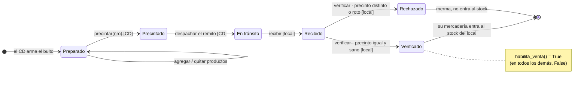
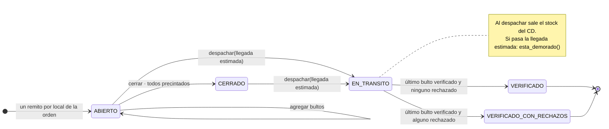
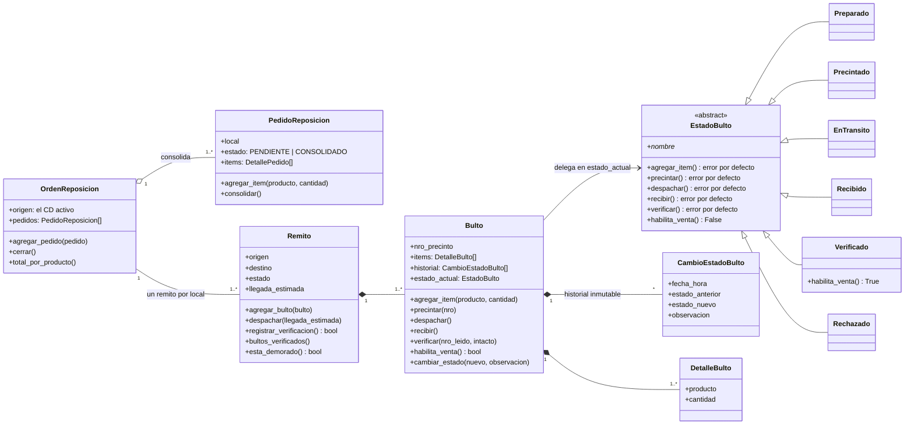
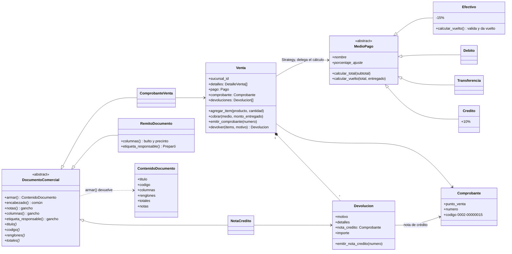
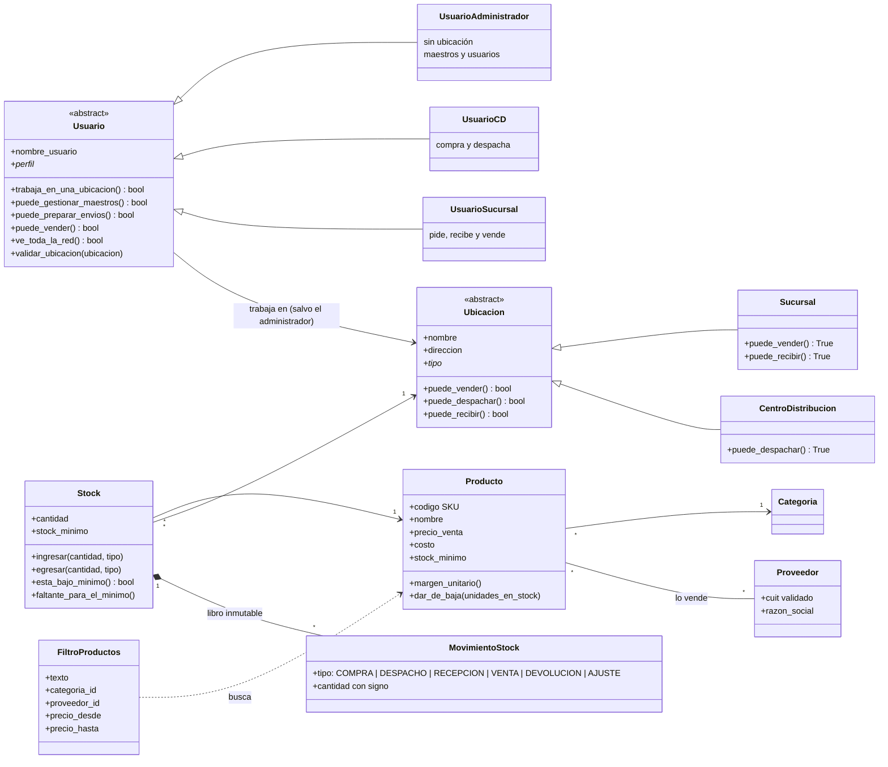
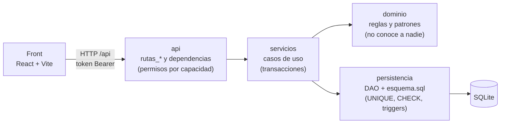

# Diagramas del TP

Están en **Mermaid**: GitHub los dibuja solos al abrir este archivo, y se
corrigen editando el texto. Para la presentación hay una imagen PNG de cada uno
en [`docs/img/`](img/) (se regeneran con `docs/img/generar.mjs`).

1. [Estados del bulto (patrón State)](#1-estados-del-bulto-patrón-state)
2. [Estados del remito](#2-estados-del-remito)
3. [Clases: logística y patrón State](#3-clases-logística-y-patrón-state)
4. [Clases: ventas, Strategy y Template Method](#4-clases-ventas-strategy-y-template-method)
5. [Clases: maestros, stock y usuarios](#5-clases-maestros-stock-y-usuarios)
6. [Capas](#6-capas)

---

## 1. Estados del bulto (patrón State)

Cada estado es una clase (`backend/dominio/estados_bulto.py`) que permite solo
sus transiciones; cualquier otra acción lanza `TransicionDeEstadoInvalida`.
Cada cambio queda en el historial (inmutable: triggers en la base) con quién lo
hizo. Solo **Verificado** habilita la venta (`habilita_venta()`).

## 2. Estados del remito

El remito no usa State: su ciclo es lineal y no cambia de comportamiento según
el estado (son constantes en `Remito`). Pasa a su estado final cuando se
verifica el **último** bulto; recién ahí entra el stock al local.

## 3. Clases: logística y patrón State

`crear_estado(nombre)` (fábrica simple con el diccionario `ESTADOS_BULTO`)
vuelve a armar el objeto estado a partir del texto que se guarda en la base.

## 4. Clases: ventas, Strategy y Template Method

`armar()` es el **método plantilla**: fija el orden (encabezado, renglones,
totales, notas) y cada documento completa solo los pasos marcados con `*`; los
ganchos tienen un valor por defecto. `RemitoDocumento` (el remito del envío)
redefine dos ganchos y no toca `armar()`.
El PDF lo dibuja `servicios/documentos_pdf.py` a partir del `ContenidoDocumento`,
sin saber qué documento es.

## 5. Clases: maestros, stock y usuarios

Los perfiles y las ubicaciones se diferencian en **qué pueden hacer**, no en sus
datos: las rutas y los services preguntan `usuario.puede_vender()` o
`ubicacion.puede_despachar()`, nunca comparan el tipo con un `if`. Las fábricas
`crear_usuario` y `crear_ubicacion` arman la clase según el texto guardado.

## 6. Capas

Cada validación está en tres lugares: el **formato** en el dominio, lo que
**consulta la base** en el service, y **UNIQUE, CHECK, claves foráneas y
triggers** en la base.
