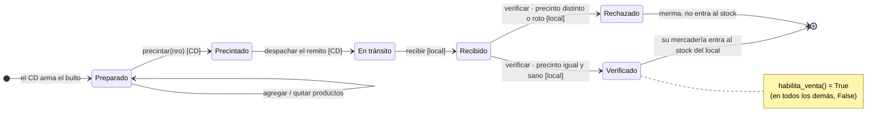
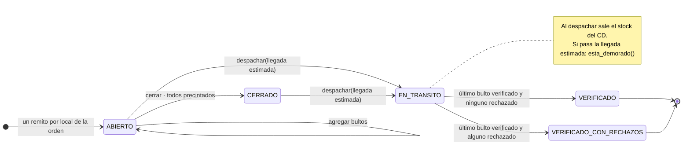
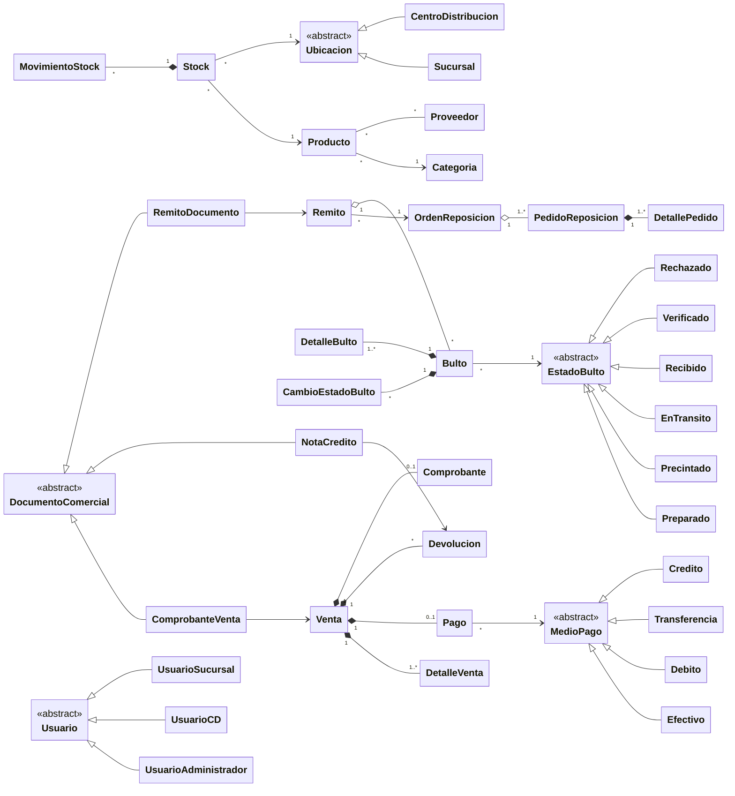
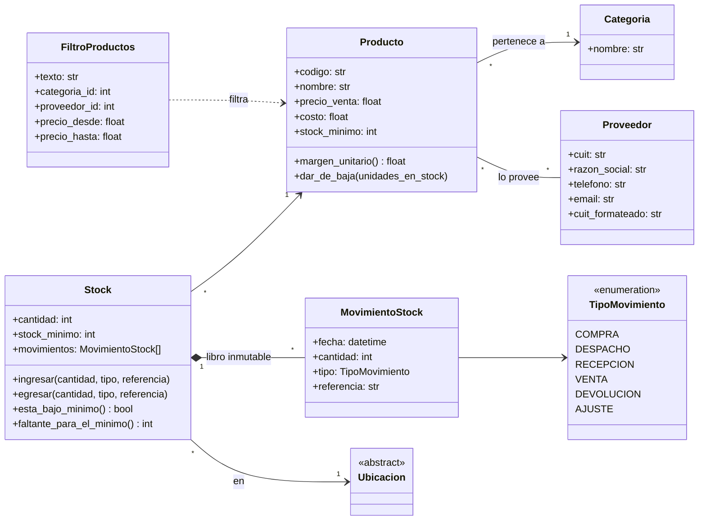
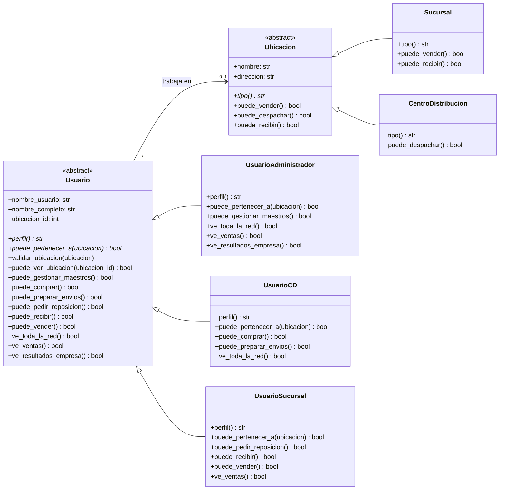
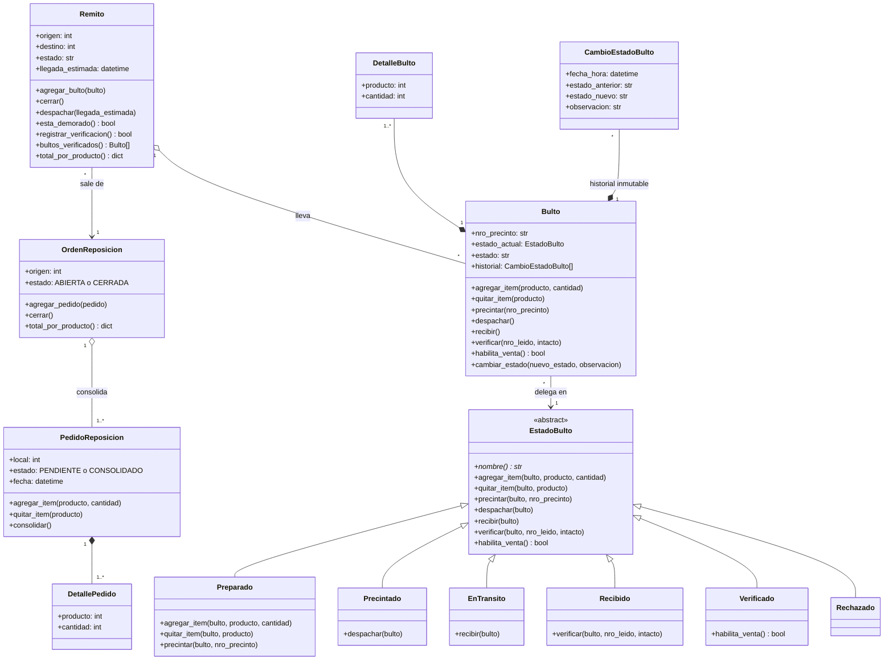
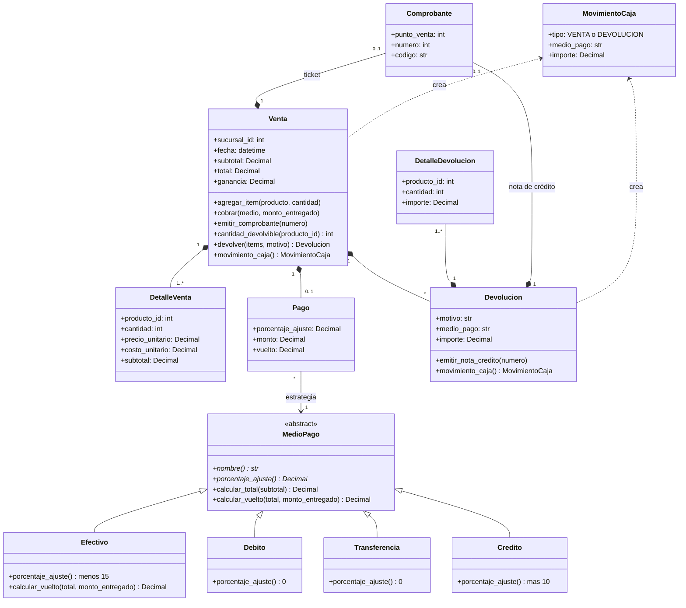
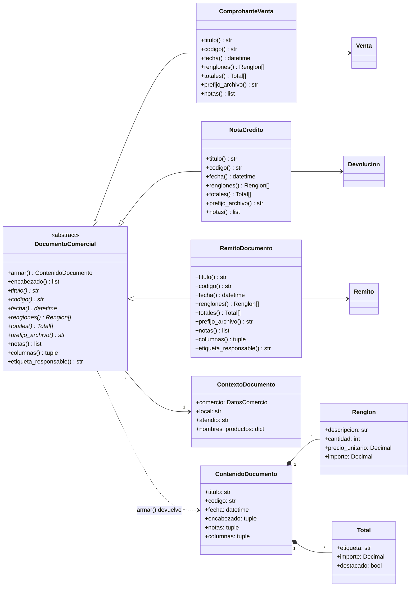
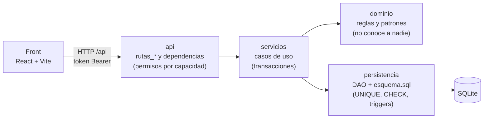

# Diagramas del TP

Están en **Mermaid**: GitHub los dibuja solos al abrir este archivo, y se
corrigen editando el texto. Para la presentación hay una imagen PNG y un SVG
(se amplía sin perder nitidez) de cada uno en [`docs/img/`](img/); se
regeneran con `node docs/img/generar.mjs`. El Word con todos los diagramas de
clases explicados es [`docs/diagrama_de_clases.docx`](diagrama_de_clases.docx);
si cambia un diagrama, hay que reemplazar su imagen en el Word.

1. [Estados del bulto (patrón State)](#1-estados-del-bulto-patrón-state)
2. [Estados del remito](#2-estados-del-remito)
3. [Clases: mapa general](#3-clases-mapa-general)
4. [Clases: productos, proveedores y stock](#4-clases-productos-proveedores-y-stock)
5. [Clases: ubicaciones y usuarios](#5-clases-ubicaciones-y-usuarios)
6. [Clases: logística y patrón State](#6-clases-logística-y-patrón-state)
7. [Clases: ventas y patrón Strategy](#7-clases-ventas-y-patrón-strategy)
8. [Clases: documentos y patrón Template Method](#8-clases-documentos-y-patrón-template-method)
9. [Capas](#9-capas)
10. [Clases: diagrama completo (para entregar)](#10-clases-diagrama-completo-para-entregar)

En los diagramas de clases (3 a 8) están las clases de `backend/dominio/`. Para
que se lean, de cada clase van los atributos y métodos que hacen a las reglas
del negocio: no se repiten los que tienen todas los maestros (`id`, `activo`,
`dar_de_baja()`, `reactivar()`). En las hijas figuran solo los métodos que
redefinen. Los métodos con `*` son abstractos.

---

## 1. Estados del bulto (patrón State)

Cada estado es una clase (`backend/dominio/estados_bulto.py`) que permite solo
sus transiciones; cualquier otra acción lanza `TransicionDeEstadoInvalida`.
Cada cambio queda en el historial (inmutable: triggers en la base) con quién lo
hizo. Solo **Verificado** habilita la venta (`habilita_venta()`).

## 2. Estados del remito

El remito no usa State: su ciclo es lineal y no cambia de comportamiento según
el estado (son constantes en `Remito`). Pasa a su estado final cuando se
verifica el **último** bulto; recién ahí entra el stock al local.

## 3. Clases: mapa general

Todas las clases del dominio, solo con su nombre, para ver cómo se conectan.
El detalle de cada grupo está en los diagramas 4 a 8. Para que se lea, acá no
van las flechas hacia la ubicación: el pedido, la orden, el remito y la venta
guardan el id de su local o del CD en un atributo, y el usuario "trabaja en"
una ubicación (diagrama 5).

Algunas relaciones están escritas al revés (`DetalleBulto --* Bulto` en vez
de `Bulto *-- DetalleBulto`, acá y en los diagramas 6 y 7): significan lo
mismo, solo cambian dónde ubica Mermaid cada caja para que las líneas no pasen
por detrás de otras clases.

## 4. Clases: productos, proveedores y stock

El stock es de un producto en una ubicación y solo cambia con `ingresar()` y
`egresar()`: cada cambio deja un `MovimientoStock` (inmutable, con la cantidad
con signo). `egresar()` no deja vender más de lo que hay (`StockInsuficiente`).

## 5. Clases: ubicaciones y usuarios

Las ubicaciones y los perfiles se diferencian en **qué pueden hacer**, no en
sus datos: las rutas y los services preguntan `usuario.puede_vender()` o
`ubicacion.puede_despachar()`, nunca comparan el tipo con un `if`. Cada perfil
dice con qué ubicación es compatible preguntándole a la ubicación
(`puede_pertenecer_a`). Las fábricas `crear_ubicacion` y `crear_usuario` arman
la clase según el texto guardado en la base.

## 6. Clases: logística y patrón State

El local pide (`PedidoReposicion`), el CD junta los pedidos en una
`OrdenReposicion`, arma un `Remito` por local con sus bultos y los despacha. El
`Bulto` no decide nada solo: **delega en su `estado_actual`** (patrón State).
`EstadoBulto` lanza `TransicionDeEstadoInvalida` por defecto y cada estado
redefine solo lo que puede hacer. El estado cambia únicamente por
`cambiar_estado()`, que deja el registro en el historial.

`crear_estado(nombre)` (fábrica simple con el diccionario `ESTADOS_BULTO`)
vuelve a armar el objeto estado a partir del texto que se guarda en la base.

## 7. Clases: ventas y patrón Strategy

La venta se arma en tres pasos: `agregar_item()` → `cobrar()` →
`emitir_comprobante()`. Al cobrar, **no sabe con qué le pagan**: le pide el
total y el vuelto al `MedioPago` que recibe (patrón Strategy). Agregar un medio
nuevo es escribir una clase más, sin tocar `Venta`. Las devoluciones las arma
`Venta.devolver()`, que valida contra lo vendido.

## 8. Clases: documentos y patrón Template Method

`armar()` es el **método plantilla**: fija el orden (encabezado, renglones,
totales, notas) y cada documento completa solo los pasos abstractos; los
ganchos (`notas()`, `columnas()`, `etiqueta_responsable()`) tienen un valor por
defecto. `RemitoDocumento` redefine dos ganchos y no toca `armar()`. El PDF lo
dibuja `servicios/documentos_pdf.py` a partir del `ContenidoDocumento`, sin
saber qué documento es.

## 9. Capas

Cada validación está en tres lugares: el **formato** en el dominio, lo que
**consulta la base** en el service, y **UNIQUE, CHECK, claves foráneas y
triggers** en la base.

## 10. Clases: diagrama completo (para entregar)

Las clases del dominio en un solo diagrama, con los mismos atributos y métodos
que los diagramas 4 a 8 (los de las reglas del negocio). No están las
excepciones ni `Periodo`. En los estados y los medios de pago concretos
figuran todos los métodos que implementan, incluidos los abstractos de la
madre (`nombre()` y `porcentaje_ajuste()`: efectivo −15 %, crédito +10 %,
débito y transferencia 0).

Usa el motor **ELK** de Mermaid, que traza las líneas en ángulo recto
esquivando las cajas (con el de siempre, alguna herencia pasaba por detrás de
otra clase y parecía que esa clase heredaba). GitHub todavía no dibuja ELK:
para verlo, abrir el PDF A3
([`docs/img/10-clases-diagrama-completo-para-entregar.pdf`](img/10-clases-diagrama-completo-para-entregar.pdf)),
que es vectorial y se amplía sin perder nitidez, o el SVG.

```mermaid
%%{init: {"layout": "elk", "class": {"hideEmptyMembersBox": true}}}%%
%% pdf A3
classDiagram
    direction TB
    class Categoria {
        +nombre: str
    }
    class Producto {
        +codigo: str
        +nombre: str
        +precio_venta: float
        +costo: float
        +stock_minimo: int
        +margen_unitario() float
        +dar_de_baja(unidades_en_stock)
    }
    class Proveedor {
        +cuit: str
        +razon_social: str
        +telefono: str
        +email: str
        +cuit_formateado: str
    }
    class FiltroProductos {
        +texto: str
        +categoria_id: int
        +proveedor_id: int
        +precio_desde: float
        +precio_hasta: float
    }
    class Stock {
        +cantidad: int
        +stock_minimo: int
        +movimientos: MovimientoStock[]
        +ingresar(cantidad, tipo, referencia)
        +egresar(cantidad, tipo, referencia)
        +esta_bajo_minimo() bool
        +faltante_para_el_minimo() int
    }
    class MovimientoStock {
        +fecha: datetime
        +cantidad: int
        +tipo: TipoMovimiento
        +referencia: str
    }
    class TipoMovimiento {
        <<enumeration>>
        COMPRA
        DESPACHO
        RECEPCION
        VENTA
        DEVOLUCION
        AJUSTE
    }
    class Ubicacion {
        <<abstract>>
        +nombre: str
        +direccion: str
        +tipo()* str
        +puede_vender() bool
        +puede_despachar() bool
        +puede_recibir() bool
    }
    class Sucursal {
        +tipo() str
        +puede_vender() bool
        +puede_recibir() bool
    }
    class CentroDistribucion {
        +tipo() str
        +puede_despachar() bool
    }
    class PedidoReposicion {
        +local: int
        +estado: PENDIENTE o CONSOLIDADO
        +fecha: datetime
        +agregar_item(producto, cantidad)
        +quitar_item(producto)
        +consolidar()
    }
    class DetallePedido {
        +producto: int
        +cantidad: int
    }
    class OrdenReposicion {
        +origen: int
        +estado: ABIERTA o CERRADA
        +agregar_pedido(pedido)
        +cerrar()
        +total_por_producto() dict
    }
    class Remito {
        +origen: int
        +destino: int
        +estado: str
        +llegada_estimada: datetime
        +agregar_bulto(bulto)
        +cerrar()
        +despachar(llegada_estimada)
        +esta_demorado() bool
        +registrar_verificacion() bool
        +bultos_verificados() Bulto[]
        +total_por_producto() dict
    }
    class Bulto {
        +nro_precinto: str
        +estado_actual: EstadoBulto
        +estado: str
        +historial: CambioEstadoBulto[]
        +agregar_item(producto, cantidad)
        +quitar_item(producto)
        +precintar(nro_precinto)
        +despachar()
        +recibir()
        +verificar(nro_leido, intacto)
        +habilita_venta() bool
        +cambiar_estado(nuevo_estado, observacion)
    }
    class DetalleBulto {
        +producto: int
        +cantidad: int
    }
    class CambioEstadoBulto {
        +fecha_hora: datetime
        +estado_anterior: str
        +estado_nuevo: str
        +observacion: str
    }
    class EstadoBulto {
        <<abstract>>
        +nombre()* str
        +agregar_item(bulto, producto, cantidad)
        +quitar_item(bulto, producto)
        +precintar(bulto, nro_precinto)
        +despachar(bulto)
        +recibir(bulto)
        +verificar(bulto, nro_leido, intacto)
        +habilita_venta() bool
    }
    class Preparado {
        +nombre() str
        +agregar_item(bulto, producto, cantidad)
        +quitar_item(bulto, producto)
        +precintar(bulto, nro_precinto)
    }
    class Precintado {
        +nombre() str
        +despachar(bulto)
    }
    class EnTransito {
        +nombre() str
        +recibir(bulto)
    }
    class Recibido {
        +nombre() str
        +verificar(bulto, nro_leido, intacto)
    }
    class Verificado {
        +nombre() str
        +habilita_venta() bool
    }
    class Rechazado {
        +nombre() str
    }
    class Venta {
        +sucursal_id: int
        +fecha: datetime
        +subtotal: Decimal
        +total: Decimal
        +ganancia: Decimal
        +agregar_item(producto, cantidad)
        +cobrar(medio, monto_entregado)
        +emitir_comprobante(numero)
        +cantidad_devolvible(producto_id) int
        +devolver(items, motivo) Devolucion
        +movimiento_caja() MovimientoCaja
    }
    class DetalleVenta {
        +producto_id: int
        +cantidad: int
        +precio_unitario: Decimal
        +costo_unitario: Decimal
        +subtotal: Decimal
    }
    class Pago {
        +porcentaje_ajuste: Decimal
        +monto: Decimal
        +vuelto: Decimal
    }
    class Comprobante {
        +punto_venta: int
        +numero: int
        +codigo: str
    }
    class Devolucion {
        +motivo: str
        +medio_pago: str
        +importe: Decimal
        +emitir_nota_credito(numero)
        +movimiento_caja() MovimientoCaja
    }
    class DetalleDevolucion {
        +producto_id: int
        +cantidad: int
        +importe: Decimal
    }
    class MovimientoCaja {
        +tipo: VENTA o DEVOLUCION
        +medio_pago: str
        +importe: Decimal
    }
    class MedioPago {
        <<abstract>>
        +nombre()* str
        +porcentaje_ajuste()* Decimal
        +calcular_total(subtotal) Decimal
        +calcular_vuelto(total, monto_entregado) Decimal
    }
    class Efectivo {
        +nombre() str
        +porcentaje_ajuste() Decimal
        +calcular_vuelto(total, monto_entregado) Decimal
    }
    class Debito {
        +nombre() str
        +porcentaje_ajuste() Decimal
    }
    class Transferencia {
        +nombre() str
        +porcentaje_ajuste() Decimal
    }
    class Credito {
        +nombre() str
        +porcentaje_ajuste() Decimal
    }
    class DocumentoComercial {
        <<abstract>>
        +armar() ContenidoDocumento
        +encabezado() list
        +titulo()* str
        +codigo()* str
        +fecha()* datetime
        +renglones()* Renglon[]
        +totales()* Total[]
        +prefijo_archivo()* str
        +notas() list
        +columnas() tuple
        +etiqueta_responsable() str
    }
    class ComprobanteVenta {
        +titulo() str
        +codigo() str
        +fecha() datetime
        +renglones() Renglon[]
        +totales() Total[]
        +prefijo_archivo() str
        +notas() list
    }
    class NotaCredito {
        +titulo() str
        +codigo() str
        +fecha() datetime
        +renglones() Renglon[]
        +totales() Total[]
        +prefijo_archivo() str
        +notas() list
    }
    class RemitoDocumento {
        +titulo() str
        +codigo() str
        +fecha() datetime
        +renglones() Renglon[]
        +totales() Total[]
        +prefijo_archivo() str
        +notas() list
        +columnas() tuple
        +etiqueta_responsable() str
    }
    class ContextoDocumento {
        +comercio: DatosComercio
        +local: str
        +atendio: str
        +nombres_productos: dict
    }
    class ContenidoDocumento {
        +titulo: str
        +codigo: str
        +fecha: datetime
        +encabezado: tuple
        +notas: tuple
        +columnas: tuple
    }
    class Renglon {
        +descripcion: str
        +cantidad: int
        +precio_unitario: Decimal
        +importe: Decimal
    }
    class Total {
        +etiqueta: str
        +importe: Decimal
        +destacado: bool
    }
    class Usuario {
        <<abstract>>
        +nombre_usuario: str
        +nombre_completo: str
        +ubicacion_id: int
        +perfil()* str
        +puede_pertenecer_a(ubicacion)* bool
        +validar_ubicacion(ubicacion)
        +puede_ver_ubicacion(ubicacion_id) bool
        +puede_gestionar_maestros() bool
        +puede_comprar() bool
        +puede_preparar_envios() bool
        +puede_pedir_reposicion() bool
        +puede_recibir() bool
        +puede_vender() bool
        +ve_toda_la_red() bool
        +ve_ventas() bool
        +ve_resultados_empresa() bool
    }
    class UsuarioAdministrador {
        +perfil() str
        +puede_pertenecer_a(ubicacion) bool
        +puede_gestionar_maestros() bool
        +ve_toda_la_red() bool
        +ve_ventas() bool
        +ve_resultados_empresa() bool
    }
    class UsuarioCD {
        +perfil() str
        +puede_pertenecer_a(ubicacion) bool
        +puede_comprar() bool
        +puede_preparar_envios() bool
        +ve_toda_la_red() bool
    }
    class UsuarioSucursal {
        +perfil() str
        +puede_pertenecer_a(ubicacion) bool
        +puede_pedir_reposicion() bool
        +puede_recibir() bool
        +puede_vender() bool
        +ve_ventas() bool
    }

    Producto "*" --> "1" Categoria : pertenece a
    Producto "*" -- "*" Proveedor : lo provee
    FiltroProductos ..> Producto : filtra
    Stock "*" --> "1" Producto
    Stock "*" --> "1" Ubicacion : en
    MovimientoStock "*" --* "1" Stock : libro inmutable
    MovimientoStock --> TipoMovimiento
    Ubicacion <|-- Sucursal
    Ubicacion <|-- CentroDistribucion

    PedidoReposicion "1" *-- "1..*" DetallePedido
    OrdenReposicion "1" o-- "1..*" PedidoReposicion : consolida
    Remito "*" --> "1" OrdenReposicion : sale de
    Remito "1" o-- "*" Bulto : lleva
    Bulto "*" --> "1" EstadoBulto : delega en
    EstadoBulto <|-- Preparado
    EstadoBulto <|-- Precintado
    EstadoBulto <|-- EnTransito
    EstadoBulto <|-- Recibido
    EstadoBulto <|-- Verificado
    EstadoBulto <|-- Rechazado
    Bulto "1" *-- "1..*" DetalleBulto
    Bulto "1" *-- "*" CambioEstadoBulto : historial inmutable

    Pago "*" --> "1" MedioPago : estrategia
    MedioPago <|-- Efectivo
    MedioPago <|-- Debito
    MedioPago <|-- Transferencia
    MedioPago <|-- Credito
    Venta "1" *-- "1..*" DetalleVenta
    Venta "1" *-- "0..1" Pago
    Venta "1" *-- "*" Devolucion
    Comprobante "0..1" --* "1" Venta : ticket
    Devolucion "1" *-- "1..*" DetalleDevolucion
    Comprobante "0..1" --* "1" Devolucion : nota de crédito
    Venta ..> MovimientoCaja : crea
    Devolucion ..> MovimientoCaja : crea

    DocumentoComercial <|-- ComprobanteVenta
    DocumentoComercial <|-- NotaCredito
    DocumentoComercial <|-- RemitoDocumento
    ComprobanteVenta --> Venta
    NotaCredito --> Devolucion
    RemitoDocumento --> Remito
    DocumentoComercial "*" --> "1" ContextoDocumento
    DocumentoComercial ..> ContenidoDocumento : armar() devuelve
    ContenidoDocumento "1" *-- "*" Renglon
    ContenidoDocumento "1" *-- "*" Total

    Usuario <|-- UsuarioAdministrador
    Usuario <|-- UsuarioCD
    Usuario <|-- UsuarioSucursal
```

